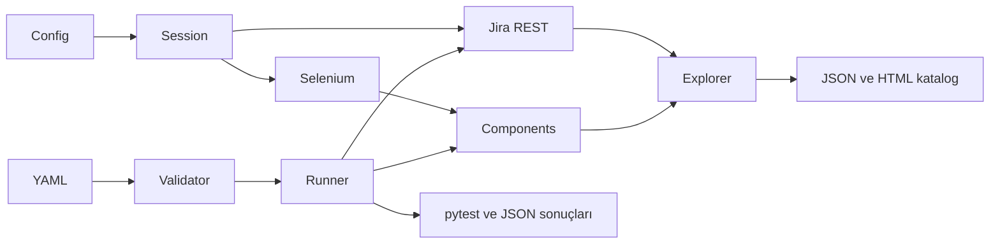

# Mimari ve genişletme

Paket `src/jira_test` altında sorumluluklarına göre ayrılmıştır:

| Parça | Sorumluluk |
|---|---|
| config, errors | Ortam ayarları, güvenli hata sınıfları |
| client | REST v2, sayfalama, çalıştırmaya ait kayıtların yazma sınırı |
| browser, session | Selenium yaşam döngüsü ve tek hesap bağlamı |
| components, ui | Alan adaptörleri ve issue işlem ekranları |
| explorer, ui_discovery | Salt okunur API/UI keşfi ve sınırlı browser fallback |
| catalog, report | Kaynakları ayrı tutan snapshot ve escaped HTML |
| scenario, runner | Deklaratif şema doğrulama ve gerçek işlem/assertion yürütme |
| pytest_plugin, cli | YAML collection, Python fixture ve komutlar |



Komponent seçimi `schema.custom`, `schema.system` ve `schema.type` üzerinden yapılır.
Yerleşik Jira custom field anahtarları açık allowlist ile tanınır. Standart alan
komponenti, alan ID'sine göre seçilmiş DOM elementini kullanır; karmaşık widget için
locator input/iframe/konteyneri göstermelidir.

## Locator uyarlaması

Yapılandırma CSS selector override'ları kabul eder:

```yaml
locators:
  edit.description: 'iframe[id="description-wysiwyg"]'
  edit.customfield_10012: '#custom-widget-input'
  edit.customfield_10012.error: '#custom-widget-error'
  transition.31.button: '#action_id_31'
  transition.root: '#issue-workflow-transition'
```

Önce güvenilir ID, ardından sabit data attribute tercih edin. Locator override ile
project/type/parent kontrollerini etkisizleştirmeyin. Form değişimi DOM gözleminden
anlaşılmalıdır; statik sleep ve global implicit wait kullanılmaz.

## Adaptör ekleme

Yeni alan sınıfı `FieldComponent` veya uygun mevcut komponentten türetilir; `fill`,
`clear` ve gerekiyorsa `read` metodlarını gerçek widget davranışına göre uygular.
`jira_session.registry.register(schema_key, ComponentClass)` çağrısıyla tarayıcıyı
başlatmadan önce kaydedilir. Session registry nesnesi UI ile paylaşılır.

Tam örnek `examples/python/test_04_custom_adapter.py` dosyasında bulunur. Örnekteki
`vendor:uppercase-text` hayali bir şemadır; gerçek eklentinizin anahtarını ve widget
uygulamasını kullanın. Basit benzerlikler için yeni inheritance katmanları eklemeyin.

## Davranış ve operasyon sınırları

Test hazırlığı API kullanır; sınanan eylem Selenium kullanır. Geçiş koşulları,
validator'lar ve farklı statüler açık senaryolarla doğrulanır. Explorer ekranları
kaydetmeden inceler; daha önce gözlenmeyen statülere geçmek için mutasyon yapmaz.

Issue kimlikleri yalnız mevcut çalıştırmada oluşturulduktan ve proje/summary marker
REST ile doğrulandıktan sonra yazılabilir kabul edilir. Taşıma, reparent ve delete
işlemleri sunulmaz. HTTP redirect ve yazma retry kapalıdır. Kayıtlar otomatik
silinmez; izinli temizlik ayrı bir operasyon olarak ele alınmalıdır.

İlk sürüm seri çalışır; xdist/çoklu kullanıcı için oturum ve rapor izolasyonu ayrıca
uyarlanmalıdır. Fixture hazırlık hatası kalan test kayıtlarını geri almaz; çalıştırma
raporunda kayıtlar gösterilir. Kaynak ve test projesi eşitliği otomatik kanıtlanmaz;
Jira yöneticisinin yapılandırma eşlemesi ve test projesi keşfi gereklidir.
